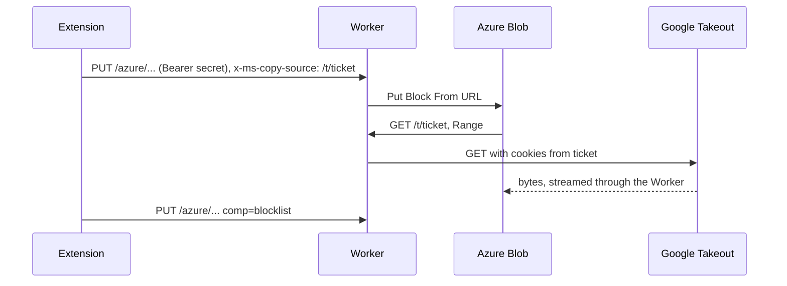

# GTR Proxy

Cloudflare Worker that lets a browser copy Google Takeout archives to Azure Blob Storage without the data passing through the browser. It is the server half of the [GTR extension](https://github.com/kjiwa/gtr-ext).

This is a fork of [nelsonjchen/gtr-proxy](https://github.com/nelsonjchen/gtr-proxy) with an incompatible protocol. It does not work with the upstream extension or the upstream public instance, and there is no public instance: you deploy your own.

## Why a proxy

- Takeout downloads need Google cookies. Azure's `Put Block From URL` can fetch a URL but cannot send cookies, so something must fetch from Google on Azure's behalf.
- Azure Blob endpoints speak HTTP/1.1, which limits a browser to 6 parallel requests. Relaying the control calls through a Worker over HTTP/2 or HTTP/3 lifts that limit.
- Workers charge no egress, and a streaming response costs almost no CPU time.



## Deploy

[](https://deploy.workers.cloudflare.com/?url=https://github.com/kjiwa/gtr-proxy)

Or from a clone (Node 24):

```sh
npm ci
openssl rand -base64 32 | tr '+/' '-_' | tr -d '='   # prints a new secret
npx wrangler secret put GTR_SECRET                   # paste it
npx wrangler deploy
```

Enter the same secret and the Worker URL in the extension's settings. The extension's Test connection button calls `/health` and reports what is wrong.

The Worker answers 503 on every route until `GTR_SECRET` is set.

## Security model

- The extension seals the Takeout URL and your Google cookies into a ticket: AES-256-GCM under a key derived from the secret, with a 6 hour expiry. Azure, Cloudflare logs and anyone who sees the URL get ciphertext, never cookies.
- `/azure/*` and `/health` require `Authorization: Bearer <secret>`. Without the secret nobody can use your Worker as a relay. Comparisons are constant time.
- The Worker fetches only Google Takeout hosts over HTTPS (see `src/takeout.ts`), follows redirects only to those hosts, forwards only `Range` plus the ticket's cookies upstream, and strips `Set-Cookie` from the response.
- The Azure relay forwards only `x-ms-*`, `content-length` and `content-type`, and only to `<account>.blob.core.windows.net`.
- Nothing sensitive is logged: each request logs its route and status.
- The Worker sees your cookies and SAS token in transit, which is why you run it yourself.

## Protocol

| Route                       | Auth       | Purpose                                                 |
| --------------------------- | ---------- | ------------------------------------------------------- |
| `GET /health`               | Bearer     | `{"version":"3.0.0"}`                                   |
| `GET, HEAD /t/<ticket>`     | the ticket | Fetch a Takeout archive; 403 invalid, 410 expired       |
| `PUT /azure/<acct>/<c>/<b>` | Bearer     | Relay to `https://<acct>.blob.core.windows.net/<c>/<b>` |

Errors are JSON: `{"error":"<code>","message":"<text>"}`.

Ticket: `base64url(iv[12] || AES-GCM(deflate-raw({"u":url,"c":cookies,"exp":epochSeconds})))`. The key is HKDF-SHA256 over the UTF-8 bytes of the secret, salt `gtr-proxy`, info `ticket v1`. `test/vectors.json` pins the format and is shared byte for byte with the extension.

## Development

```sh
npm ci
npm test            # vitest in workerd
npm run lint
npm run typecheck
cp .dev.vars.example .dev.vars   # set GTR_SECRET, then: npm run dev
```

After changing bindings in `wrangler.jsonc`, run `npm run types`.

## License

MIT OR Apache-2.0, at your option.
